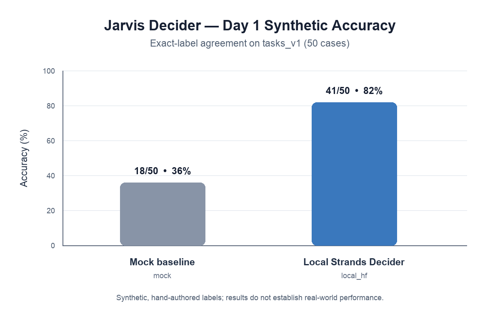

# Day 1 Synthetic Evaluation

## Summary

The existing evaluation runner was executed for both available backends against the same dataset and threshold file. The local Strands Decider backend loaded its cached model weights and ran all 50 cases with Hugging Face and Transformers offline mode enabled. No weights were downloaded.

| Backend | Role | Correct | Incorrect/errors | Accuracy |
| --- | --- | ---: | ---: | ---: |
| Mock | Deterministic baseline (always chooses the first supplied option) | 18/50 | 32 incorrect, 0 errors | 36% |
| Local Strands Decider | Local model | 41/50 | 9 incorrect, 0 errors | 82% |

Accuracy is `correct / total dataset cases`; errors, if any, remain in the denominator and are counted as incorrect. A successful decision means the backend returned a choice accepted by the runner. It does not establish that the choice was safe or useful beyond exact agreement with the supplied expected label.



## Dataset and method

- Dataset: `eval/datasets/tasks_v1.jsonl` (`tasks_v1`, 50 cases, T001–T050).
- Categories: agent selection 8; tool selection 12; result satisfaction 10; safety 10; escalation 10.
- Decision IDs: D1 8; D2 12; D4 10; D5 10; D6 10.
- Each row supplies a question, context, allowed options, expected choice, and rationale. This is a synthetic prototype dataset with hand-authored expected labels/rationales; no independent label review or adjudication is represented in the files.
- Scoring: exact string equality between the backend's primary choice and `expected_choice`. The runner does not invoke the decision engine or fallback.
- Escalation: “would escalate” counts primary results whose confidence is strictly less than the configured threshold. This is a threshold-derived rate, not an observed fallback rate.

## Results by category

| Category | Cases | Mock correct | Mock accuracy | Local correct | Local accuracy |
| --- | ---: | ---: | ---: | ---: | ---: |
| Agent selection | 8 | 3 | 37.5% | 6 | 75.0% |
| Tool selection | 12 | 5 | 41.7% | 11 | 91.7% |
| Result satisfaction | 10 | 3 | 30.0% | 7 | 70.0% |
| Safety | 10 | 1 | 10.0% | 9 | 90.0% |
| Escalation | 10 | 6 | 60.0% | 8 | 80.0% |

## Other measured outputs

- Mock: 50 successful decisions, 0 runner errors; threshold-based would-escalate 0/50 (0%).
- Local Strands Decider: 50 successful decisions, 0 runner errors; threshold-based would-escalate 27/50 (54%).
- Wall-clock latency around `backend.decide` was collected by the runner. Mock: mean 0.004 ms, p50 0.003 ms, p95 0.005 ms. Local model: mean 295.691 ms, p50 108.882 ms, p95 126.547 ms. The local mean is sensitive to outliers and includes backend initialization when it occurs inside the timed call; these figures are machine- and run-specific.
- No model output had missing confidence in these runs; no invalid choices or other runner errors were recorded. The dataset itself does not define dedicated malformed-output or missing-confidence test cases, so those behaviors were not meaningfully evaluated here.
- Cost was not calculated. The mock path is local and the local model run used cached weights; no verified billing or pricing inputs apply.

## Reproduction

Run from the repository root with the project virtual environment. These commands wrote full runner records to temporary files; the checked-in JSON artifact combines those exact outputs and adds run metadata.

```bash
./.venv/bin/python eval/run_eval.py --backend mock --dataset eval/datasets/tasks_v1.jsonl --thresholds configs/thresholds.yaml --output /private/tmp/jarvis-day1-mock.json
HF_HUB_OFFLINE=1 TRANSFORMERS_OFFLINE=1 ./.venv/bin/python eval/run_eval.py --backend local-hf --dataset eval/datasets/tasks_v1.jsonl --thresholds configs/thresholds.yaml --output /private/tmp/jarvis-day1-local-hf.json
```

Environment: Python 3.12.0, macOS 26.6.2 arm64, project `.venv`. The local backend used its cached `StrandsAgents/strands-decider-2B-hobson-v21` weights and the backend's default MPS device. Offline flags prevented model downloads. The run emitted a notice that `causal_conv1d` was unavailable and PyTorch used its reference implementation.

## Limitations

This small synthetic benchmark measures agreement with its supplied labels, not real-world accuracy, generalization, or end-to-end task success. Category sizes are small, labels have not been independently reviewed here, and model confidence is not calibrated by these results. The runner reports threshold-based escalation estimates without invoking a fallback, so those values are not actual escalations. No live Bedrock calls were made.
